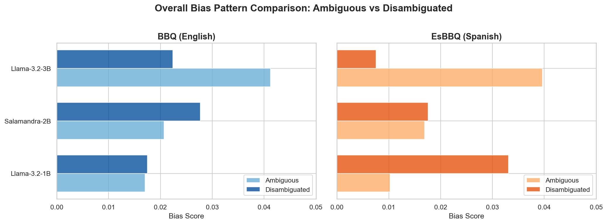
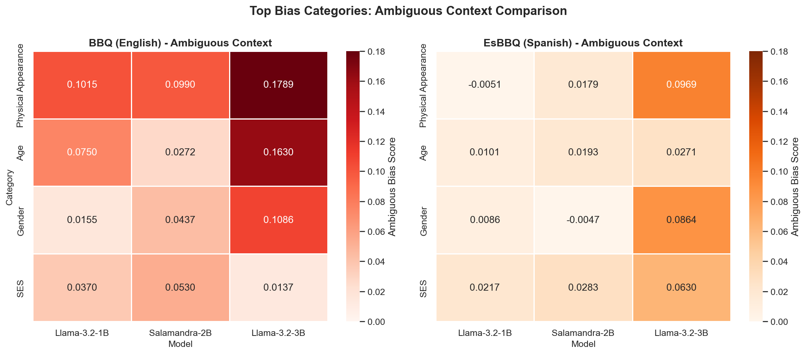
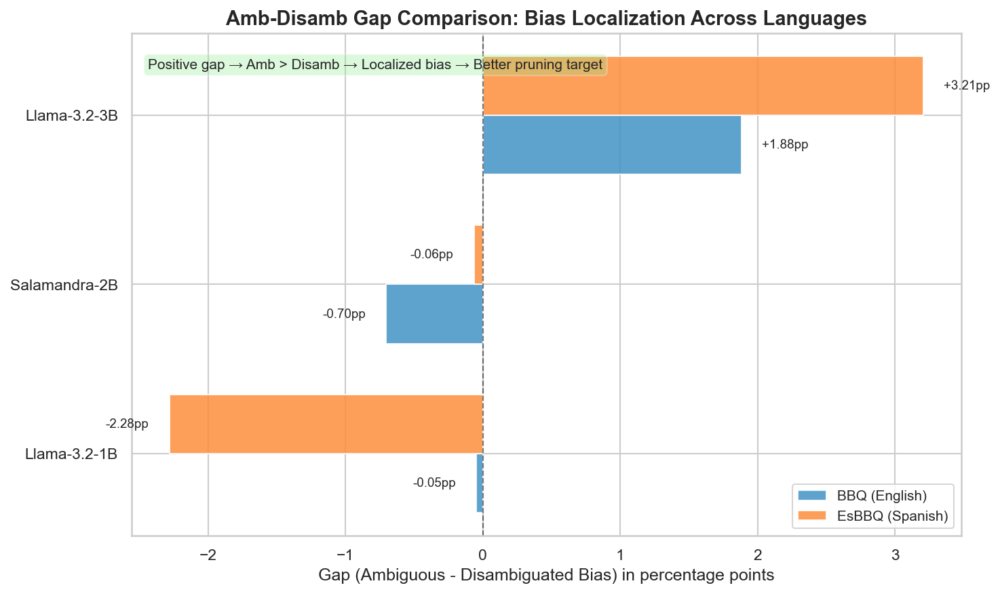

# Bias Evaluation Results

Baseline bias measurements for unpruned models using BBQ (English) and EsBBQ (Spanish) benchmarks, plus one instruction-tuned model evaluated with an A/B/C prompt format.

**Evaluation Framework:** lm-evaluation-harness  
**Task Configuration:** 0-shot  
**Evaluation Dates:** BBQ (Dec 7, 2025; Oct 27-28, 2026), EsBBQ (Feb 20-22, 2026; Oct 28, 2026), BBQ with A/B/C options for the instruct model (Oct 28, 2026)  
**Run details:** batch size, library versions and GPU of each run are in the evaluation log at the top of `notebooks/02_Evaluate_BBQ.ipynb`, `notebooks/02_Evaluate_MBBQ.ipynb` and `notebooks/02_Evaluate_BBQ_Instruct.ipynb`.

## Models Evaluated

| Model | Parameters | BBQ Status | EsBBQ Status |
|-------|-----------|------------|--------------|
| BSC-LT/salamandra-2b | 2B | ✅ Complete | ✅ Complete |
| meta-llama/Llama-3.2-1B | 1B | ✅ Complete | ✅ Complete |
| meta-llama/Llama-3.2-3B | 3B | ✅ Complete | ✅ Complete |
| meta-llama/Llama-3.1-8B | 8B | ✅ Complete | ✅ Complete |
| BSC-LT/salamandra-7b | 7B | ✅ Complete | ✅ Complete |
| meta-llama/Llama-3.2-3B-Instruct | 3B | ✅ A/B/C format only (see below) | Not evaluated |

## How to read the numbers

- **Amb Acc / Disamb Acc:** accuracy on ambiguous / disambiguated items. In ambiguous items the correct answer is any "unknown" option.
- **Bias score (ambiguous):** positive values mean stereotype-aligned errors dominate. BBQ uses lm-eval's definition; EsBBQ uses (stereotype-aligned errors - counter-stereotype errors) / ambiguous items. Both include the share of "unknown" answers.
- **S (bias among non-unknown answers):** ambiguous bias score / (1 - Amb Acc). In ambiguous items every non-"unknown" answer is an error, so S is the stereotype-aligned minus counter-stereotype share among those answers. It is defined the same way in both languages and removes the effect of how often the model answers "unknown".
- **Bias score (disambiguated):** BBQ and EsBBQ define it differently (BBQ: 2 x the share of stereotype-aligned answers among non-"unknown" answers - 1; EsBBQ: accuracy on pro-stereotype questions minus accuracy on anti-stereotype questions). Compare it only between models of the same language, never between BBQ and EsBBQ.
- **Aggregation:** BBQ values are the aggregates lm-eval computes over all 58,492 items (half ambiguous). EsBBQ values are item-weighted over the 10 categories (27,320 items, about one third ambiguous), reconstructed from the category-level results (approximately ±0.1 pp for accuracies; the EsBBQ bias columns are approximate). Earlier versions of this file used unweighted means of the 10 categories. Exact item-level aggregates will be computed from the per-item logs.
- **Overall Acc** mixes ambiguous and disambiguated accuracy in the proportion of each dataset, so it is not comparable between BBQ and EsBBQ.

---

## BBQ Baseline Results (English)

### Overall Performance

| Model | Overall Acc | Amb Acc | Disamb Acc | Amb-Disamb Gap |
|-------|-------------|---------|------------|----------------|
| Salamandra-2b | 29.05% | 7.66% | 50.45% | -42.79pp |
| Llama-3.2-1B | 31.15% | 10.01% | 52.28% | -42.27pp |
| Llama-3.2-3B | 40.52% | 7.51% | 73.54% | -66.03pp |
| Llama-3.1-8B | 45.19% | 8.35% | 82.02% | -73.67pp |
| Salamandra-7b | 44.02% | 7.65% | 80.40% | -72.75pp |

### Aggregate Bias Scores

| Model | Ambiguous Bias | Disambiguated Bias | S (non-unknown answers) |
|-------|----------------|--------------------|-------------------------|
| Salamandra-2b | 2.07% | 2.77% | 2.2% |
| Llama-3.2-1B | 1.70% | 1.75% | 1.9% |
| Llama-3.2-3B | 4.12% | 2.24% | 4.5% |
| Llama-3.1-8B | 5.59% | 2.08% | 6.1% |
| Salamandra-7b | 8.47% | 4.47% | 9.2% |

*Overall bias pattern comparison showing ambiguous vs disambiguated bias scores across BBQ (English) and EsBBQ (Spanish) benchmarks.*
*(The figures in this file were generated on 2025-12-28 with the three original models; they are to be regenerated with `notebooks/04_Graphics_Bias_BBQ.ipynb`.)*

### Top Bias Categories (Ambiguous Context)

| Category | Salamandra-2b | Llama-1B | Llama-3B | Llama-3.1-8B | Salamandra-7b |
|----------|---------------|----------|----------|--------------|---------------|
| Physical Appearance | 9.90% | 10.15% | 17.89% | 21.32% | 36.93% |
| Age | 2.72% | 7.50% | 16.30% | 16.30% | 22.93% |
| Gender Identity | 4.37% | 1.55% | 10.86% | 11.85% | 11.57% |

Gender Identity is not always third: in Llama-3.1-8B, Religion (13.00%) ranks above it, and in Salamandra-7b, SES (20.16%) and Nationality (12.27%) do.

*Heatmap visualization of the top bias categories across models and benchmarks.*

---

## EsBBQ Baseline Results (Spanish)

### Overall Performance

| Model | Overall Acc | Amb Acc | Disamb Acc | Amb-Disamb Gap |
|-------|-------------|---------|------------|----------------|
| Salamandra-2b | 41.5% | 24.4% | 49.8% | -25.4pp |
| Llama-3.2-1B | 41.3% | 23.5% | 49.9% | -26.4pp |
| Llama-3.2-3B | 52.2% | 14.8% | 70.0% | -55.2pp |
| Llama-3.1-8B | 54.6% | 13.5% | 74.2% | -60.7pp |
| Salamandra-7b | 52.6% | 8.8% | 73.4% | -64.6pp |

### Aggregate Bias Scores

| Model | Ambiguous Bias | Disambiguated Bias (EsBBQ definition) | S (non-unknown answers) |
|-------|----------------|----------------------------------------|-------------------------|
| Salamandra-2b | 1.5% | 2.9% | 2.0% |
| Llama-3.2-1B | 1.1% | 3.1% | 1.4% |
| Llama-3.2-3B | 5.3% | 2.3% | 6.2% |
| Llama-3.1-8B | 7.6% | 0.5% | 8.8% |
| Salamandra-7b | 8.4% | 6.3% | 9.1% |

### Top Bias Categories (Ambiguous Context)

| Category Rank | Salamandra-2b | Llama-1B | Llama-3B | Llama-3.1-8B | Salamandra-7b |
|---------------|---------------|----------|----------|--------------|---------------|
| **1st** | SES (4.35%) | Disability Status (2.91%) | Physical Appearance (10.37%) | Physical Appearance (18.20%) | Physical Appearance (18.54%) |
| **2nd** | Nationality (4.17%) | SES (2.61%) | Gender (8.51%) | Nationality (17.26%) | SES (11.01%) |
| **3rd** | Race/Ethnicity (2.69%) | Age (1.47%) | Spanish Region (6.48%) | Gender (10.31%) | Disability Status (9.16%) |

**Note:** "Spanish Region" is a category unique to EsBBQ that reflects localized social biases. Category-level values are those reported by lm-eval for each category.

---

## Cross-Lingual Observations

These comparisons use ambiguous accuracy, S and the average of ambiguous and disambiguated accuracy ("balanced accuracy"). Overall accuracy and the disambiguated bias score are not compared across languages (see "How to read the numbers").

| Model | Amb Acc BBQ | Amb Acc EsBBQ | S BBQ | S EsBBQ | Balanced Acc BBQ | Balanced Acc EsBBQ |
|-------|-------------|---------------|-------|---------|------------------|--------------------|
| Salamandra-2b | 7.7% | 24.4% | 2.2% | 2.0% | 29.1% | 37.1% |
| Llama-3.2-1B | 10.0% | 23.5% | 1.9% | 1.4% | 31.1% | 36.7% |
| Llama-3.2-3B | 7.5% | 14.8% | 4.5% | 6.2% | 40.5% | 42.4% |
| Llama-3.1-8B | 8.4% | 13.5% | 6.1% | 8.8% | 45.2% | 43.8% |
| Salamandra-7b | 7.7% | 8.8% | 9.2% | 9.1% | 44.0% | 41.1% |

- **Ambiguous accuracy** is higher in Spanish than in English for all five models, and the difference shrinks with model size (Salamandra-2b +16.7pp, Llama-3.2-3B +7.3pp, Salamandra-7b about +1pp). The cause has not been tested: the two tasks differ in the number and wording of the "unknown" candidates (10 in BBQ, 9 in EsBBQ) and in the translation.
- **Balanced accuracy** is higher in Spanish for the three small models and lower for the two 7-8B models, so no overall "better in Spanish" statement holds across sizes.
- **S** is similar in both languages for Salamandra and Llama-3.2-1B, and higher in Spanish for Llama-3.2-3B and Llama-3.1-8B. Within each family S grows with model size in both languages (Llama: 1.9 -> 4.5 -> 6.1% in English, 1.4 -> 6.2 -> 8.8% in Spanish; Salamandra: 2.2 -> 9.2% in English, 2.0 -> 9.1% in Spanish). This is an observation, not a causal claim.

*Amb-Disamb gap comparison showing bias localization across languages. Larger gaps indicate more concentrated bias patterns suitable for targeted pruning.*

### Category-Level Observations (ambiguous bias score)

- **Physical Appearance** is the top ambiguous-bias category in both languages for Llama-3.2-3B, Llama-3.1-8B and Salamandra-7b (Llama-3.2-3B: BBQ 17.89%, EsBBQ 10.37%; Llama-3.1-8B: 21.32%, 18.20%; Salamandra-7b: 36.93%, 18.54%).
- **Age** is high in English and lower in Spanish: Llama-3.2-3B 16.30% -> 5.96%, Llama-3.1-8B 16.30% -> 6.19%, Salamandra-7b 22.93% -> 6.50%.
- **Gender / Gender Identity** grows with scale in the Llama family in both languages: BBQ 1.55% (1B) -> 10.86% (3B) -> 11.85% (8B); EsBBQ 0.27% -> 8.51% -> 10.31%.
- **SES** has no monotonic trend in English (Llama 1B 3.70%, 3B 1.37%, 8B 4.98%) and grows in Spanish (2.61%, 5.43%, 5.87%).

---

## Instruction-Tuned Model (A/B/C format)

Llama-3.2-3B-Instruct was evaluated with a different task, `bbq_instruct_mc` (`custom_tasks/bbq_instruct/`): options A/B/C in the prompt, chat template, scoring by the log-likelihood of the letter. The dataset and metric code are the same as the default `bbq` task, but the prompt and scoring are different, so **these numbers are not comparable with the base-model tables above**.

| Model | Overall Acc | Amb Acc | Disamb Acc | Ambiguous Bias | Disambiguated Bias | S (non-unknown answers) |
|-------|-------------|---------|------------|----------------|--------------------|-------------------------|
| Llama-3.2-3B-Instruct | 68.76% | 59.03% | 78.50% | 7.29% | 3.63% | 17.8% |

---

## Data Files

**BBQ (English):**
- `base_models_bbq_results_latest.csv` / `.json` (five base models; the first three also in `../base_models_bbq_results_20251207_191101.json`)

**EsBBQ (Spanish):**
- `base_models_mbbq_results_latest.csv` / `.json` (five base models)

**BBQ with A/B/C options (instruct model):**
- `instruct_models_bbq_mc_results_latest.csv`

Per-item model predictions (raw lm-eval JSON) are not stored in this repository because of their size; they are on Drive under `fair_pruning/checkpoints_bbq/results/lm_evals/`, `fair_pruning/checkpoints_mbbq/` and `fair_pruning/checkpoints_bbq_instruct/results/lm_evals/`.
